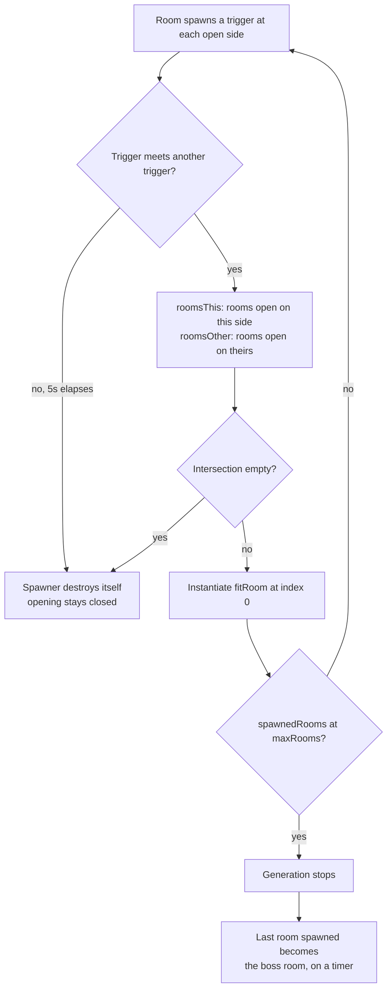
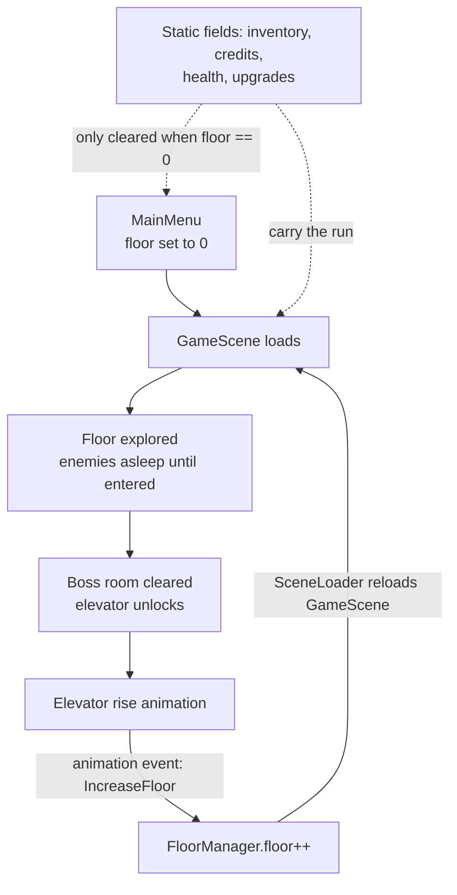
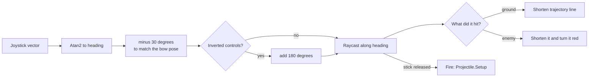

# Zenith Tower

<p align="center">
  
</p>

An endless mobile dungeon crawler for Android. Climb a procedurally generated tower, clear each floor to unlock the doors, and spend credits on upgrades that carry between floors.

Built in Unity 2020.3 with the Universal Render Pipeline. 45 C# scripts, roughly 4,000 lines. Published to Google Play in 2024 and delisted when I stopped shipping updates.

**Status: archived.** This is a record of the code, not a maintained project. I am not taking issues or PRs.

<!-- TODO: drop a screenshot or short GIF from the Play Store listing here. -->

## Running it

Two packages used during development could not be redistributed, so they are not in this repo. One of them is required to compile.

1. Open the project in **Unity 2020.3.34f1**.
2. Import these free Asset Store packages before anything else:
   - [Joystick Pack](https://assetstore.unity.com/packages/tools/input-management/joystick-pack-107631) by Fenerax Studios. **Required to compile.** `CharacterMovement` and `CharacterShooting` both declare a `Joystick` field.
   - [WarFX](https://assetstore.unity.com/packages/vfx/particles/war-fx-5669) by Jean Moreno. Required for the particle effects to resolve.
3. Open `Assets/Scenes/MainMenu.unity` and press play.

`THIRD-PARTY.md` explains exactly what was removed, why, and how the imports reconnect the existing references.

If you want to build an APK, supply your own signing keystore. The original one was removed from this repo.

## How the dungeon is built

This is the part worth reading. `Assets/Scripts/Level/`.

Each room prefab advertises which of its four sides are open. A `RoomSpawner` trigger sits at every opening, holding an `openingDirection` (1 bottom, 2 top, 3 left, 4 right). `RoomTemplates` keeps four arrays of room prefabs, one per opening side.

When two spawners touch, generation asks a harder question than "what fits me". It needs a room that fits **both** sides of the join. `RoomSpawner.OnTriggerEnter` does that with a set intersection:

```csharp
// roomsThis  = rooms that fit this opening's direction
// roomsOther = rooms that fit the direction the other spawner needs
if (roomsThis.Intersect(roomsOther).Any())
{
    var matchingRoom = roomsThis.Intersect(roomsOther);
    GameObject[] fitRoom = matchingRoom.ToArray();
    GameObject newRoom = Instantiate(fitRoom[0], transform.position, fitRoom[0].transform.rotation);
    newRoom.transform.parent = GameObject.FindGameObjectWithTag("Level").transform;
}
```

So a room is only placed if it satisfies the opening it meets and the opening it presents to the next room. Two cleanup rules keep generation finite: a spawner destroys itself after five seconds if nothing ever joins to it, and `Spawn()` bails once `templates.spawnedRooms.Count` reaches `maxRooms`.



Each room is then populated by `RoomSetup`, which registers itself with `RoomTemplates`, instantiates a door for every opening, and drops in one of the `floorPresets` enemy layouts.

Floors get harder by construction rather than by tuning. `RoomTemplates.Awake()` sets `maxRooms = floor * 2 + 12`, so the layout grows with depth, and it blends two adjacent enemy preset arrays above floor zero, so a floor draws from the layouts belonging to that depth and the one below it.

The boss room is wherever generation happened to stop. `RoomTemplates` waits out a fixed timer after the scene loads and then calls `MakeBossRoom()` on `spawnedRooms[spawnedRooms.Count - 1]`, the room spawned last. That swaps its enemy preset for a boss encounter and places the elevator to the next floor inside it.

## How a run works

There is no save system. State lives in `static` C# fields, and the run resets by reloading the scene.



Riding the elevator increments `FloorManager.floor` and reloads `GameScene`, but no script calls the increment. It is an animation event named `IncreaseFloor` on `ElevatorRise.anim`, which fires partway up and invokes the private method on the `Elevator` component. Nothing in the C# refers to it, so the link is invisible unless you open the clip.

Floor 0 is the only place state gets cleared, in four separate `if (FloorManager.floor == 0)` guards. The statics in `InventorySystem`, `Customization`, `PlayerHealth`, and `CreditsManager` survive the reload and carry the run between floors. It worked, and it is why closing the app lost your progress.

## Combat

Aiming and firing are the same gesture. Drag the left joystick to aim, release to shoot. `CharacterShooting` converts the stick vector into a heading, applies a fixed -30° offset to match the bow pose, and raycasts along that heading to scale a trajectory line. The line turns red when the cast hits an enemy layer, so the player can see the shot land before committing to it.



You get three arrows. Each one refills on its own timer driven by a coroutine that fills an ammo bar as it goes. `Enhancements` maps seven upgrade levels (bow damage, range, reload speed, max health, damage absorption, movement speed, camera vision) onto those values through property setters.

## Room-gated AI

Enemies are disabled at spawn and enabled only when the player first enters their room, in `RoomSetup.OnFirstEnter()`. A floor holds several rooms at once, and this keeps the rest of it from simulating. When the last enemy in a room dies, `onEnemyDeath` marks the room complete and opens its doors.

## Layout

```
Assets/
  Scripts/
    Enemies/   AI, health, damage triggers
    Game/      Audio, camera, credits, projectiles, scene loading, UI
    Items/     Inventory, equipment slots, ScriptableObject item data
    Level/     Room generation, floors, doors, elevator
    MainMenu/  Customisation, settings
    Player/    Movement, bow combat, health, upgrades
  Scenes/      MainMenu, GameScene, LevelCreator
  Prefabs/     Rooms, enemies, player, UI
  Scriptable Objects/  Item definitions (damage, health, absorption tiers)
```

`LevelCreator.unity` is a tool scene I used to assemble room prefabs, not part of the shipped game.

## What I would change

Written with the benefit of a few more years.

- **Use a seed.** Generation draws from `Random`, so no two floors are reproducible. A seed would have made bugs reproducible too.
- **Pick rooms deliberately.** `Intersect` returns an unordered set and `fitRoom[0]` takes whatever comes first. Nothing prefers a dead end over a corridor or weighs difficulty, so floor layouts drift toward whatever sits at index zero.
- **Replace the five second fallback.** The self-destruct timer is how mismatched openings get cleaned up. On a slow device it can fire before the join completes, leaving a hole in the wall.
- **Choose the boss room from the graph, not a timer.** `MakeBossRoom()` runs after a fixed delay, so on a slow device it can promote a room in the middle of the layout instead of the end of it.
- **Write a real save system.** Static fields plus a scene reload were convenient at the time and cost me every player's progress the moment the app closed.
- **Pool instead of instantiate.** Enemies, projectiles, and rooms are all created with `Instantiate` and destroyed outright.
- **Stop hiding control flow in animation events.** The floor increment lives on a clip, alongside `OpenDoor`, `OnDeath`, `MakeAccessible`, `StopButtonPress` and twenty-four `PlaySound` calls. All of them are strings matching method names that nothing type-checks, so renaming a method breaks gameplay silently.

## Credits

The game code is MIT licensed, see `LICENSE`. Third-party components keep their own terms, see `THIRD-PARTY.md`:

- NavMeshComponents, MIT, Unity Technologies (included)
- Fira Sans, SIL Open Font License 1.1 (included, `Assets/Fira/OFL.txt`)
- Music, Pixabay
- WarFX and Joystick Pack, Asset Store EULA (not included)
